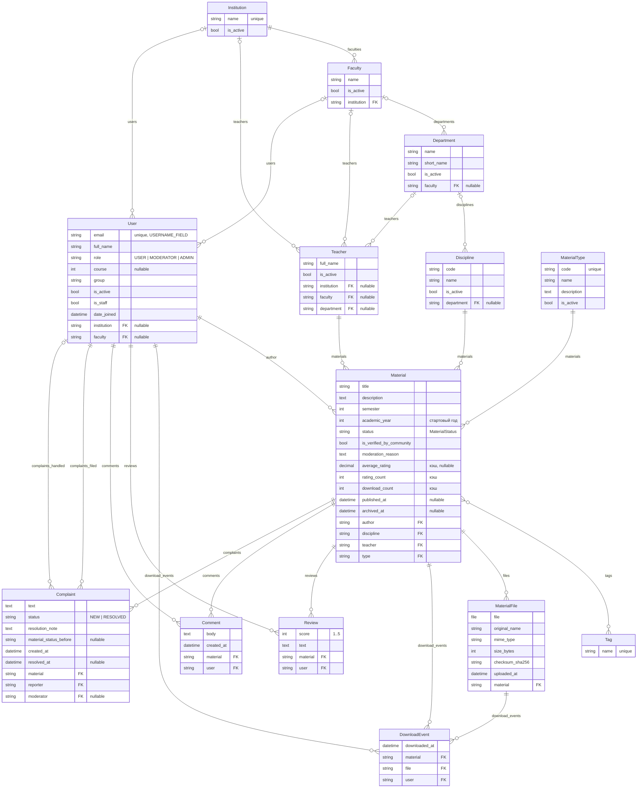

# Концептуальная схема данных StudySwap

Предварительная концептуальная схема предметной области. Отражает состав сущностей,
связи и кардинальности, ключевые атрибуты, статусы и правила целостности.
Схема согласована с реализованными моделями (реализация опережает документацию).

## ER-диаграмма

## Сущности и назначение

| Сущность | Назначение |
|---|---|
| Institution, Faculty, Department | Иерархия учебного заведения (справочники) |
| Discipline, Teacher, MaterialType | Атрибутивные справочники для поиска материалов |
| User | Учётная запись с ролью и учебными атрибутами |
| Material | Учебный материал: атрибуты, статус модерации, кэшированные метрики |
| MaterialFile | Прикреплённый файл (UUID-имя, SHA-256, размер) |
| Tag | Тег темы; связь с материалами «многие-ко-многим» |
| DownloadEvent | Факт скачивания файла пользователем (основание допуска к оценке) |
| Review | Оценка 1–5 с текстом отзыва; одна на пользователя на материал |
| Comment | Комментарий/вопрос в обсуждении материала |
| Complaint | Жалоба пользователя и результат её обработки модератором |

Сущности Institution, Faculty, Department, Discipline, Teacher, MaterialType, Material,
Review наследуют `core.models.TimeStampedModel` — служебные временные метки
создания/изменения (`created_at` и др.).

## Статусы

**MaterialStatus:** `MODERATION` (на модерации) → `PUBLISHED` (опубликован) /
`REJECTED` (отклонён); из `PUBLISHED` возможны `NEEDS_REVISION` (на доработке),
`HIDDEN` (скрыт), `ARCHIVED` (в архиве).

**ComplaintStatus:** `NEW` (новая) → `RESOLVED` (обработана).

**UserRole:** `USER`, `MODERATOR`, `ADMIN`; гость — неаутентифицированный субъект.

## Ограничения целостности

- `Faculty`: уникальность пары (institution, name).
- `Review`: уникальность пары (material, user) — одна оценка на пользователя на материал.
- `Institution.name`, `MaterialType.code`, `Tag.name`, `User.email` — уникальны.
- `Review.score`: 1 ≤ score ≤ 5 (валидаторы уровня модели).
- Кэшированные поля Material (`average_rating`, `rating_count`, `download_count`) и
  служебные даты (`published_at`, `archived_at`) недоступны для ручного редактирования.

## Политики удаления

| Связь | Политика | Обоснование |
|---|---|---|
| Material → author / discipline / teacher / type | PROTECT | Нельзя удалить справочник или автора, на которых ссылается материал |
| Faculty → Institution | PROTECT | Сохранность иерархии справочников |
| Discipline → Department, Teacher → справочники, User → справочники | SET_NULL | Удаление справочника не уничтожает зависимые записи |
| MaterialFile / DownloadEvent / Review / Comment / Complaint → Material | CASCADE | Подчинённые записи не существуют без материала |
| Complaint → moderator | SET_NULL | Жалоба сохраняется после удаления учётной записи модератора |

## Бизнес-правила, отражённые в схеме

1. **Допуск к оценке:** оценка возможна только при наличии `DownloadEvent`
   (пользователь скачал материал); автор не оценивает собственный материал.
2. **Метка времени публикации:** `published_at` проставляется при первом переходе
   в `PUBLISHED` и далее не перезаписывается; `archived_at` — при первом переходе в `ARCHIVED`.
3. **Рейтинг материала:** `average_rating` = среднее `Review.score`, `rating_count` = число оценок.
4. **Рейтинг автора:** среднее оценок по всем его материалам, когда-либо опубликованным
   (`published_at IS NOT NULL`).
5. **Балльный баланс автора:** `Σ(score) − 3 × N` по тем же материалам (нейтральная оценка 3
   не изменяет баланс).
6. **Жалоба:** подаётся только на `PUBLISHED`-материал; повторная необработанная жалоба
   того же заявителя на тот же материал блокируется. При обработке фиксируются
   `moderator`, `resolution_note`, `material_status_before`, `resolved_at`.
7. **Публичность:** каталог, карточка и скачивание доступны только для `PUBLISHED`;
   скачивание — только аутентифицированным пользователям.
8. **Архивация:** автор переводит собственный опубликованный материал в `ARCHIVED`;
   физическое удаление из БД не предусмотрено.